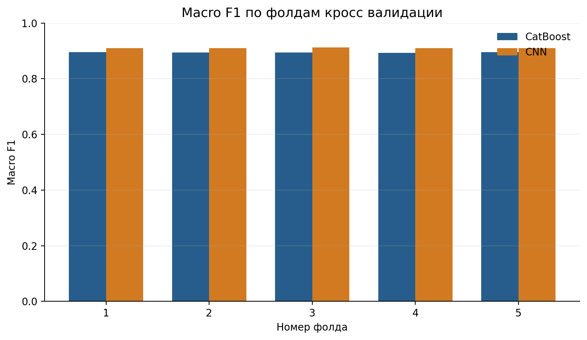
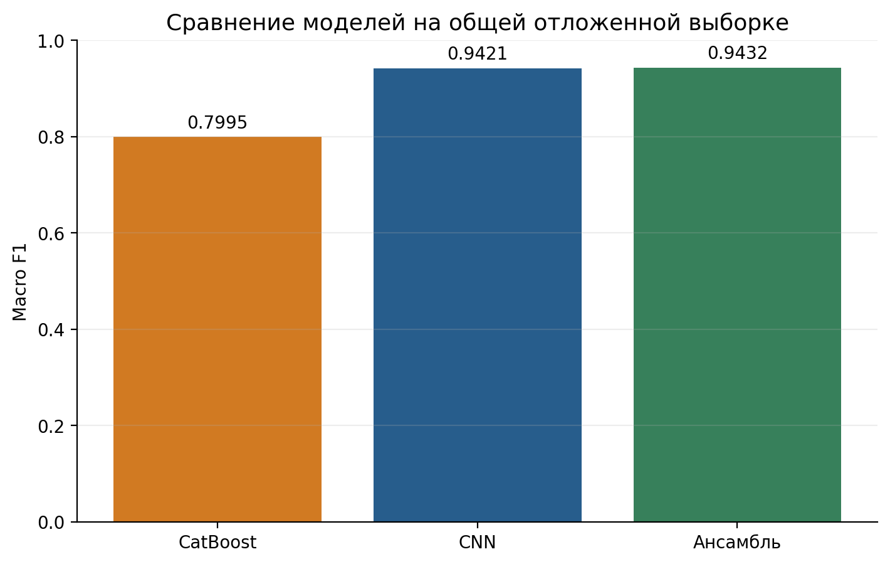
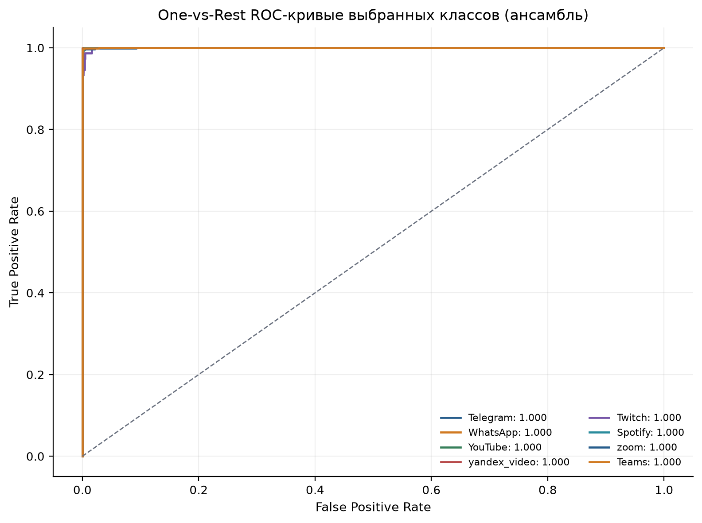
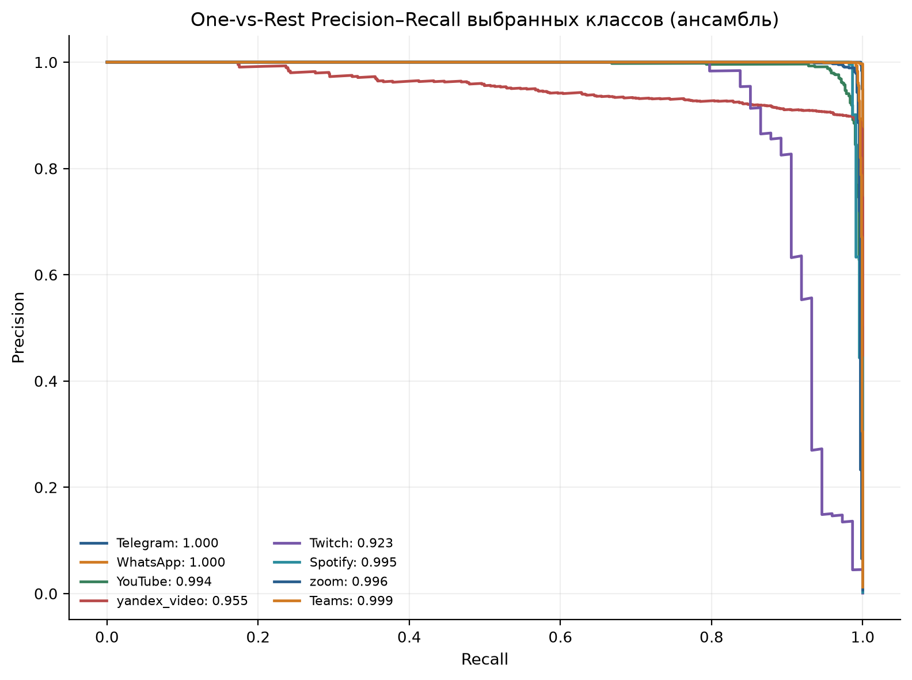

# Детектирование приложений в зашифрованном TCP-трафике

Рабочий ML-проект для соревнования `Who's Talking: Classify Encrypted TCP
Traffic`. Модель получает только 30 знаковых размеров TCP-пакетов: знак задаёт
направление, ноль является хвостовым padding.

Реализованы:

- потоковое преобразование 2.3 ГБ CSV в компактные `int16` NumPy memmap;
- 30 исходных и 33 агрегированных признака потока;
- CatBoost baseline для 252 классов;
- 1D-CNN с embeddings размера, направления и позиции пакета;
- стратифицированная K-fold кросс-валидация CatBoost и CNN с OOF-прогнозами;
- подбор ансамбля CatBoost + CNN по macro-F1;
- точный 128-битный lookup для совпадений train/test;
- корректные macro-F1, weighted-F1 и accuracy;
- потоковый анализ полного датасета и PNG-графики для отчёта;
- профили и позиционные паттерны всех 252 приложений с кластерным анализом;
- готовый [Colab notebook](traffic_detection_colab.ipynb).

## Быстрый запуск в Google Colab

1. Загрузить папку проекта в `MyDrive/Kursach/traffic_detection`.
2. Загрузить `train.csv` и `test.csv` в
   `MyDrive/Kursach/whos-talking-classify-encrypted-tcp-traffic-spring-2`.
3. Открыть `traffic_detection_colab.ipynb` и выбрать T4 GPU.
4. Последовательно выполнить ячейки.

После завершения скачайте или передайте папку
`MyDrive/Kursach/traffic_detection/colab_results`. В ней находятся веса,
submission, результаты каждого фолда, OOF-прогнозы, статистика датасета и
графики для отчёта.

Пути можно изменить во второй кодовой ячейке notebook.

## Подготовка данных

Полная команда:

```bash
python scripts/prepare_data.py \
  --input-dir /content/competition_data \
  --output-dir /content/prepared \
  --with-features
```

Слой подготовки не загружает исходный CSV целиком в оперативную память:

```python
from traffic_detection.data import convert_csv_to_memmap
from traffic_detection.features import build_feature_memmap

train = convert_csv_to_memmap(
    "/content/train.csv", "/content/prepared", split="train"
)
build_feature_memmap(
    train.packet_path,
    "/content/prepared/train_features.npy",
    batch_size=100_000,
)
```

Выходные файлы можно читать без загрузки целиком:

```python
import numpy as np

X = np.load("/content/prepared/train_features.npy", mmap_mode="r")
y = np.load("/content/prepared/train_labels.npy", mmap_mode="r")
```

По умолчанию матрица признаков содержит 30 исходных позиций и 33 агрегированных
признака. Список последних доступен как
`traffic_detection.features.FEATURE_NAMES`.

## Обучение

CatBoost baseline:

```bash
python scripts/train_catboost.py \
  --data-dir /content/prepared \
  --output-dir /content/artifacts/catboost \
  --cap-per-class 2000 --iterations 500 --task-type GPU
```

1D-CNN на полном train:

```bash
python scripts/train_cnn.py \
  --data-dir /content/prepared \
  --output-dir /content/artifacts/cnn \
  --epochs 8 --batch-size 4096 --workers 2
```

## Кросс-валидация

Данные разбиваются при помощи `StratifiedKFold`: в каждом фолде сохраняются
доли всех 252 классов, а перемешивание с фиксированным `seed=42` делает
результат воспроизводимым. Одна часть становится validation, остальные части —
обучающими; процесс повторяется так, чтобы каждая выбранная строка ровно один
раз была validation-объектом.

CatBoost, 5 фолдов и до 2000 потоков каждого класса:

```bash
python scripts/cross_validate_catboost.py \
  --data-dir /content/prepared \
  --output-dir /content/artifacts/catboost_cv \
  --folds 5 --cap-per-class 2000 \
  --iterations 500 --task-type GPU
```

CNN, 5 фолдов и до 5000 потоков каждого класса:

```bash
python scripts/cross_validate_cnn.py \
  --data-dir /content/prepared \
  --output-dir /content/artifacts/cnn_cv \
  --folds 5 --cap-per-class 5000 \
  --epochs 4 --batch-size 4096 --workers 2
```

Ограничение на число строк класса относится только к вычислительно дорогой
оценке и задаётся отдельно от итогового обучения. Значение `0` запускает CV на
всём train. Результаты сохраняются в `catboost_cv.json`/`cnn_cv.json`:
метрики каждого фолда, среднее, выборочное стандартное отклонение, минимум,
максимум и общая OOF-метрика. Файлы `oof_predictions.npy` и
`sample_indices.npy` позволяют воспроизвести расчёт. Ключ `--save-models`
дополнительно сохраняет модель каждого фолда, но для обычной оценки не нужен.

### Быстрая проверка уже обученных весов

Готовые веса нельзя честно назвать K-fold кросс-валидацией: они уже обучались
на части исходных строк, поэтому использование этих строк для проверки даст
утечку данных. Но можно без переобучения оценить стабильность модели на её
исходном независимом holdout. Скрипт восстанавливает то же разбиение по
`seed=42` и `val_size=0.05`, делает прогноз один раз и делит holdout на пять
стратифицированных частей:

```bash
python scripts/evaluate_saved_models.py \
  --data-dir /content/prepared \
  --cnn-checkpoint /content/drive/MyDrive/Kursach/traffic_detection/colab_results/best.pt \
  --catboost-model /content/drive/MyDrive/Kursach/traffic_detection/colab_results/model.cbm \
  --ensemble-config /content/drive/MyDrive/Kursach/traffic_detection/colab_results/ensemble.json \
  --output-dir /content/artifacts/saved_weights_evaluation \
  --folds 5 --val-size 0.05 --seed 42
```

Результат `saved_models_evaluation.json` содержит оценки CNN, CatBoost и
ансамбля по пяти частям. В отчёте это следует называть «оценкой стабильности
на стратифицированных частях отложенной выборки», а не K-fold CV. Полноценный
результат K-fold дают только `cross_validate_catboost.py` и
`cross_validate_cnn.py`, потому что они заново обучают модель на каждом фолде.

Перед полным прогоном рекомендуется smoke-test:

```bash
python scripts/train_cnn.py \
  --data-dir /content/prepared \
  --output-dir /content/artifacts/cnn_smoke \
  --max-train-rows 50000 --epochs 3 --batch-size 2048
```

## Предсказание и lookup

```bash
python scripts/predict_cnn.py \
  --data-dir /content/prepared \
  --checkpoint /content/artifacts/cnn/best.pt \
  --output /content/submission_cnn.csv

python scripts/tune_ensemble.py \
  --data-dir /content/prepared \
  --catboost-dir /content/artifacts/catboost \
  --cnn-dir /content/artifacts/cnn \
  --output /content/artifacts/ensemble.json

python scripts/predict_ensemble.py \
  --data-dir /content/prepared \
  --catboost-model /content/artifacts/catboost/model.cbm \
  --cnn-checkpoint /content/artifacts/cnn/best.pt \
  --ensemble-config /content/artifacts/ensemble.json \
  --output /content/submission_ensemble.csv

python scripts/apply_exact_lookup.py \
  --data-dir /content/prepared \
  --base-submission /content/submission_ensemble.csv \
  --output /content/submission_final.csv
```

Lookup нужен потому, что 473 080 тестовых последовательностей (10.0009% test)
точно присутствуют в train. Внутри train полных дубликатов нет.

## Проверенные свойства данных

- train: 8 248 546 строк, test: 4 730 370 строк;
- 252 класса, от 1 048 до 100 000 примеров на класс;
- пропусков нет, нули образуют только хвостовой padding;
- train отсортирован блоками по метке, поэтому split без shuffle запрещён;
- `sample_submission.csv` содержит лишь 11 строк и не является полным шаблоном;
- фактический submission должен содержать все test id от 0 до 4 730 369.

Короткий локальный smoke-test CatBoost на 50 400 обучающих строках, 15 120
validation-строках и всех 252 классах дал macro-F1 `0.71149`. Это проверка
пайплайна, а не итоговая оценка: использовано только 200 строк на класс и 80
итераций. CNN после одного smoke-epoch получила `0.39309`; автоматически
подобранный ансамбль с весом CNN `0.2` улучшил macro-F1 до `0.71327`.

## Графики и статистика для отчёта

В Colab этот этап выполняется автоматически после обучения. Отдельный запуск:

```bash
python scripts/generate_report_assets.py \
  --data-dir /content/prepared \
  --output-dir /content/artifacts/report_assets \
  --catboost-cv /content/artifacts/catboost_cv/catboost_cv.json \
  --cnn-cv /content/artifacts/cnn_cv/cnn_cv.json \
  --catboost-metrics /content/artifacts/catboost/metrics.json \
  --cnn-history /content/artifacts/cnn/history.json \
  --ensemble /content/artifacts/ensemble.json
```

Скрипт обрабатывает NumPy memmap пакетами и создаёт:

- `dataset_statistics.json` с точными характеристиками полного train;
- распределение всех классов и двадцати крупнейших классов;
- распределение длины потоков и размеров пакетов;
- заполненность 30 позиций последовательности;
- macro-F1 на каждом фолде;
- динамику метрик CNN по эпохам;
- сравнение CatBoost, CNN и ансамбля на общей validation-выборке.

Готовые изображения последнего полного запуска уже добавлены в репозиторий:

- [распределение длины потоков](docs/assets/report/flow_length_distribution.png);
- [распределение размеров пакетов](docs/assets/report/packet_size_distribution.png);
- [заполненность позиций 1–30](docs/assets/report/sequence_position_occupancy.png);
- [результаты пяти фолдов](docs/assets/report/cross_validation_folds.png);
- [история обучения CNN](docs/assets/report/cnn_training_history.png);
- [сравнение итоговых моделей](docs/assets/report/model_comparison.png).





### ROC, Precision–Recall и анализ ошибок

Для multiclass-задачи с 252 классами используется схема One-vs-Rest. Помимо
ROC-AUC строятся Precision–Recall, per-class F1, confusion matrix, top-k
accuracy и калибровка. Это важно: при большом числе классов ROC-AUC может быть
почти единицей из-за огромного числа отрицательных примеров, даже если для
отдельных редких классов качество заметно ниже.

Диагностика на стратифицированных 100 000 объектах исходного независимого
holdout дала:

| Модель | ROC-AUC OvR macro | Average Precision macro | Top-1 | Top-3 | ECE |
|---|---:|---:|---:|---:|---:|
| CNN | 0,99966 | **0,96336** | **0,96124** | **0,99598** | **0,02255** |
| CatBoost | 0,99897 | 0,90521 | 0,87742 | 0,96853 | 0,04145 |
| Ансамбль | **0,99968** | 0,96335 | 0,96098 | 0,99556 | 0,04909 |

Готовые результаты находятся в [`docs/assets/evaluation`](docs/assets/evaluation):

- [ROC-кривые выбранных классов](docs/assets/evaluation/roc_curves_selected_classes.png);
- [Precision–Recall выбранных классов](docs/assets/evaluation/precision_recall_selected_classes.png);
- [сравнение ROC-AUC и Average Precision](docs/assets/evaluation/auc_model_comparison.png);
- [confusion matrix](docs/assets/evaluation/confusion_matrix_top30.png);
- [классы с минимальным F1](docs/assets/evaluation/lowest_class_f1.png);
- [частые пары ошибок](docs/assets/evaluation/top_confusion_pairs.png);
- [калибровка вероятностей](docs/assets/evaluation/calibration_curves.png);
- [top-k accuracy](docs/assets/evaluation/top_k_accuracy.png).

Воспроизведение по уже подготовленным данным и сохранённым весам:

```bash
python scripts/generate_evaluation_diagnostics.py \
  --data-dir /content/prepared \
  --cnn-checkpoint /content/artifacts/cnn/best.pt \
  --catboost-model /content/artifacts/catboost/model.cbm \
  --ensemble-config /content/artifacts/ensemble.json \
  --output-dir /content/artifacts/evaluation_diagnostics \
  --max-rows 100000
```





## Анализ паттернов приложений

Подробное пошаговое исследование находится в
[`docs/data_analysis.md`](docs/data_analysis.md). В нём приведены определения
признаков, графики по меткам, сравнение Telegram, WhatsApp, YouTube, Teams,
zoom, GMail и других приложений, корреляции, позиционные профили и результаты
кластеризации.

Воспроизвести анализ непосредственно по исходному CSV:

```bash
python scripts/analyze_application_patterns.py \
  --train-csv /content/competition_data/train.csv \
  --output-dir analysis_results \
  --batch-size 250000 --clusters 5
```

Если подготовленные memmap уже созданы, повторно разбирать CSV не требуется:

```bash
python scripts/analyze_application_patterns.py \
  --data-dir /content/prepared \
  --output-dir analysis_results \
  --batch-size 250000 --clusters 5
```

Скрипт не обучает модели и не требует GPU. Он обрабатывает данные пакетами,
создаёт `application_profiles.csv`, таблицы ближайших профилей, JSON с
выводами и восемь PNG-графиков. Небольшие результаты из `analysis_results`
предназначены для публикации вместе с кодом.

## Публикация в Git

CSV, подготовленные массивы и веса исключены через `.gitignore`, поскольку они
велики и распространяются отдельно через Kaggle и Google Drive. Для нового
репозитория:

```bash
git init
git add .
git commit -m "Implement encrypted traffic application detection"
git branch -M main
git remote add origin <адрес-репозитория>
git push -u origin main
```

Необходимые итоговые JSON и PNG уже находятся в `analysis_results` и
`docs/assets/report`. В репозиторий не нужно добавлять `train.csv`, `test.csv`,
подготовленные многогигабайтные массивы, `.pt` и `.cbm`.

## Тесты

Запуск тестов из этой папки:

```bash
PYTHONPATH=src python -m unittest discover -s tests -v
```
