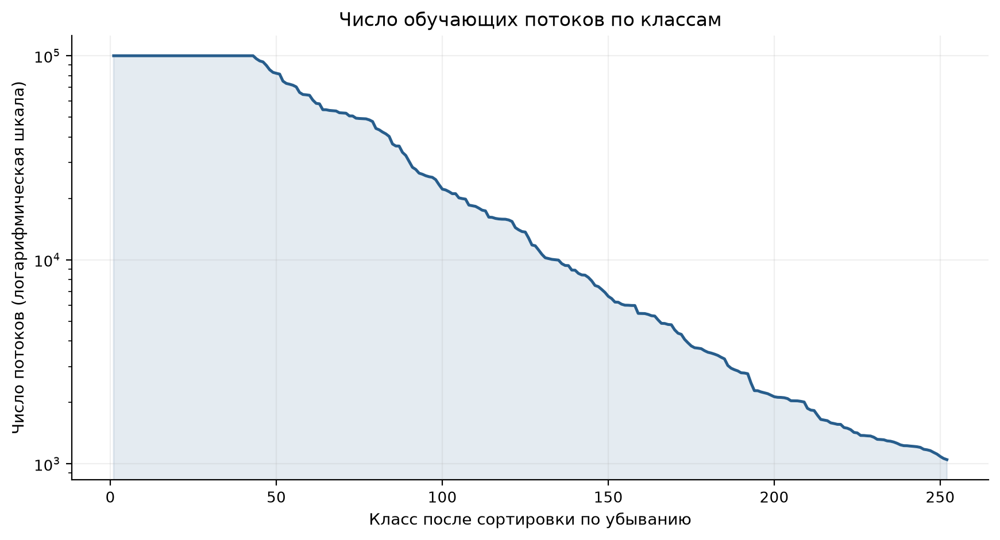
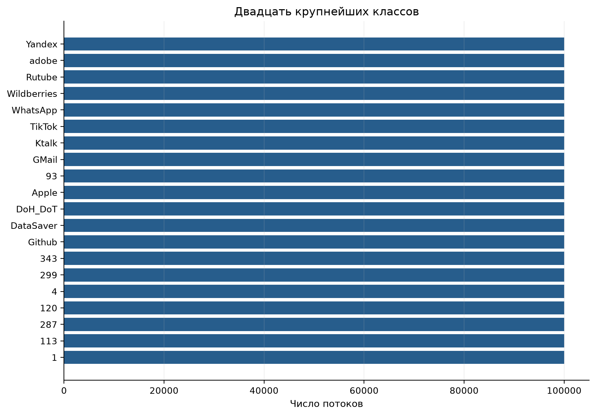
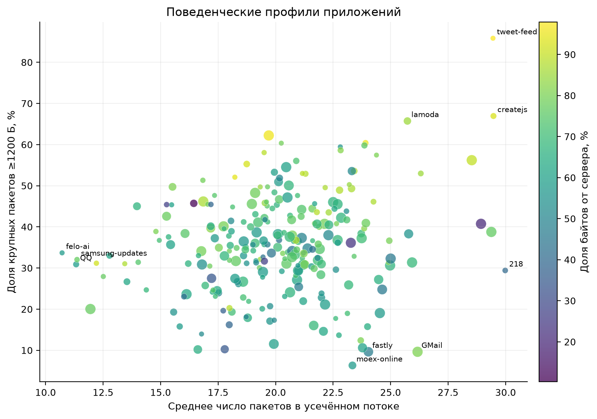
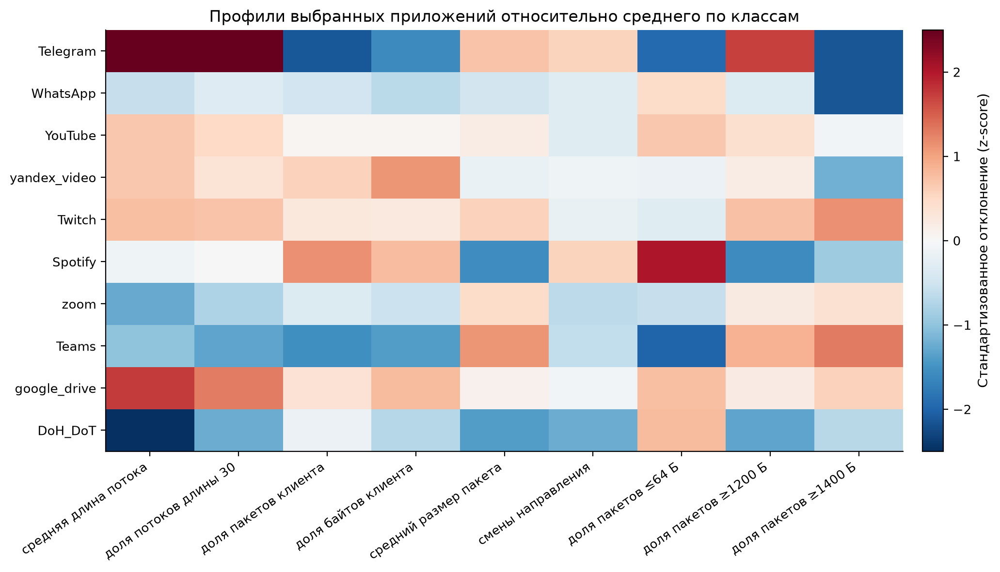
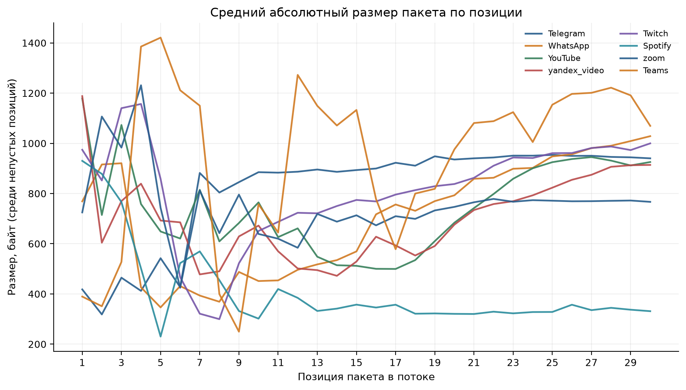
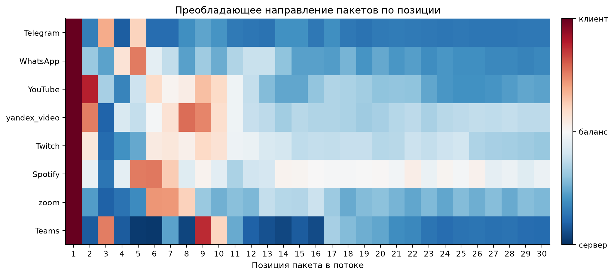
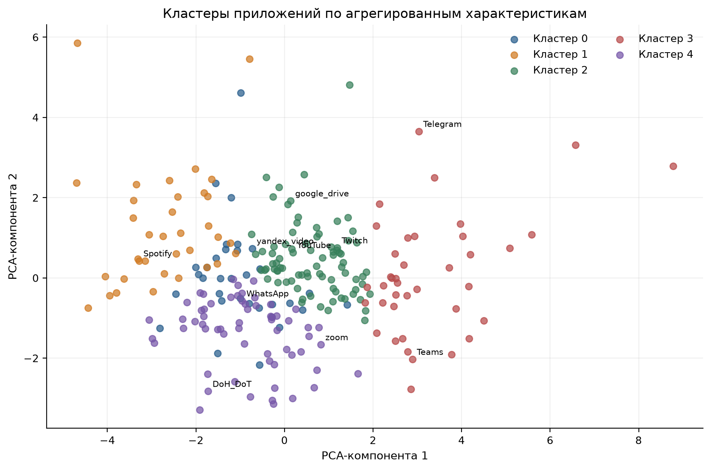
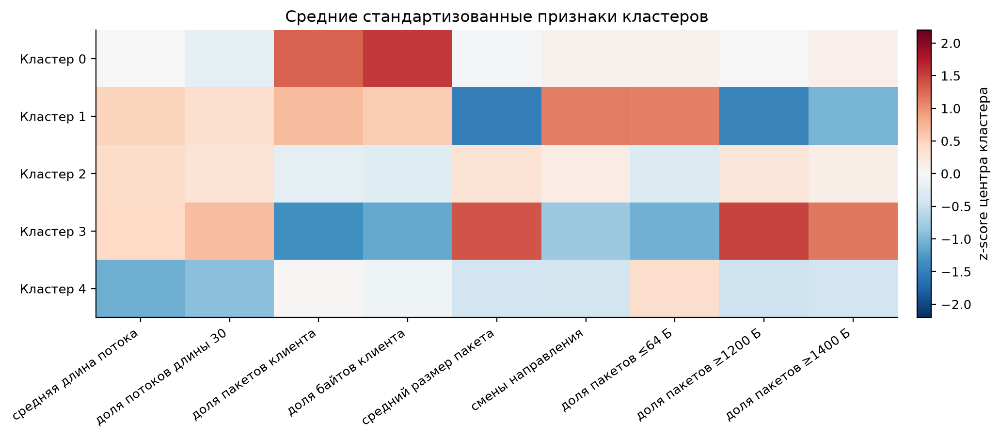

# Анализ данных и паттернов приложений

Этот документ описывает полный разведочный анализ обучающей выборки соревнования
по детектированию приложений в зашифрованном TCP-трафике. Все приведённые числа
получены скриптом [`scripts/analyze_application_patterns.py`](../scripts/analyze_application_patterns.py)
на полном `train.csv`, а не на подвыборке.

## 1. Что представляют собой данные

Одна строка — начало одного TCP-потока, усечённое до 30 пакетов:

- `app_service` — метка приложения или сервиса;
- `tcp_len_1 ... tcp_len_30` — знаковые размеры пакетов в байтах;
- положительное значение означает пакет от клиента к серверу;
- отрицательное — пакет от сервера к клиенту;
- ноль — хвостовое дополнение для потока короче 30 пакетов.

Полезная нагрузка зашифрована, поэтому содержание пакета неизвестно. Анализ
строится только по метаданным: порядку пакетов, размеру, направлению и длине
наблюдаемого фрагмента потока.

### Масштаб выборки

| Характеристика | Значение |
|---|---:|
| Обучающих потоков | 8 248 546 |
| Тестовых потоков | 4 730 370 |
| Классов приложений | 252 |
| Пакетов в одной строке | от 1 до 30 |
| Минимум объектов класса | 1 048 (`upto-like`) |
| Максимум объектов класса | 100 000 |
| Отношение максимального класса к минимальному | 95,42 |

Встречаются как текстовые метки (`Telegram`, `YouTube`, `zoom`), так и
числовые идентификаторы, сохранённые в виде строк (`1`, `113`, `218`). Для
модели это одинаковые независимые классы.

## 2. Последовательность анализа

Анализ выполнен по следующим этапам.

1. Проверка структуры CSV и семантики знака/нулей.
2. Подсчёт числа объектов каждого класса.
3. Анализ реальной длины потока и доли полностью заполненных последовательностей.
4. Анализ размеров пакетов и направления передачи.
5. Анализ смен направления внутри потока.
6. Построение профиля каждого приложения по девяти агрегированным признакам.
7. Сравнение выбранных приложений по позициям 1–30.
8. Поиск корреляций между характеристиками.
9. Кластеризация профилей приложений как дополнительный описательный анализ.
10. Формулировка выводов для выбора признаков и архитектуры модели.

Обработка выполнялась порциями по 250 000 строк. Поэтому для анализа 1,5 ГБ
CSV не требуется загружать весь файл в оперативную память.

## 3. Проверка меток и дисбаланса классов





Распределение несбалансировано. Для большого числа популярных классов имеется
ровно 100 000 потоков, что похоже на верхнее ограничение при формировании
датасета. Редчайший класс содержит 1 048 объектов. Такой дисбаланс важен по
двум причинам:

- обычная accuracy будет в основном отражать качество на крупных классах;
- для соревнования нужна `macro-F1`, где каждый из 252 классов имеет одинаковый
  вес независимо от размера.

Именно поэтому в CNN используются сглаженные веса классов, а для CatBoost и
кросс-валидации применяется ограничение максимального числа объектов одного
класса.

## 4. Определения рассчитанных признаков

Пусть поток задан последовательностью
`x = (x₁, x₂, ..., x₃₀)`, где знак кодирует направление.

### 4.1. Длина потока

```text
flow_length = Σ I(xᵢ ≠ 0)
```

Это число реально наблюдаемых пакетов. Нули не являются пакетами и не участвуют
в статистиках размера.

### 4.2. Направление

```text
client_packets = Σ I(xᵢ > 0)
server_packets = Σ I(xᵢ < 0)
client_packet_share = client_packets / flow_length
```

Для объёма трафика отдельно суммируются абсолютные размеры пакетов клиента и
сервера:

```text
client_bytes = Σ max(xᵢ, 0)
server_bytes = Σ max(-xᵢ, 0)
client_byte_share = client_bytes / (client_bytes + server_bytes)
```

### 4.3. Размеры пакетов

```text
mean_abs_packet_size = Σ |xᵢ| / flow_length
small_packet_share   = доля пакетов размером 1–64 Б
large_packet_share   = доля пакетов размером не менее 1200 Б
near_mtu_share       = доля пакетов размером не менее 1400 Б
```

Порог 1200 Б отделяет крупные сегменты, а 1400 Б показывает пакеты около
типичного сетевого MTU. Это не размер исходного сообщения приложения, а размер
отдельного наблюдаемого TCP-пакета.

### 4.4. Смены направления

```text
direction_changes = Σ I(sign(xᵢ) ≠ sign(xᵢ₊₁))
```

Пары с padding не учитываются. Большое значение соответствует частому
чередованию запросов и ответов, малое — длинным сериям передачи в одном
направлении.

## 5. Общий профиль приложений

Каждая точка на следующем графике — отдельный класс. Размер точки зависит от
числа обучающих потоков; цвет показывает долю байтов от сервера.



Приложения не образуют одну компактную группу. Одни классы характеризуются
короткими потоками и умеренными пакетами, другие — почти полностью заполненными
последовательностями с крупными серверными сегментами. Это подтверждает, что
размер и направление действительно содержат различимый сигнал даже без
расшифровки payload.

## 6. Конкретные паттерны выбранных приложений

Проценты ниже рассчитаны по всем потокам соответствующего класса.

| Приложение | Потоков | Средняя длина | Полных по 30 | Пакетов клиента | Байтов клиента | Средний размер, Б | Смен направления | Малых ≤64 Б | Крупных ≥1200 Б | Почти MTU ≥1400 Б |
|---|---:|---:|---:|---:|---:|---:|---:|---:|---:|---:|
| Telegram | 100 000 | 28,53 | 78,72% | 21,72% | 10,21% | 811 | 7,91 | 3,02% | 56,21% | 0,21% |
| WhatsApp | 100 000 | 18,27 | 23,30% | 36,65% | 23,37% | 624 | 6,41 | 22,78% | 31,70% | 0,19% |
| YouTube | 49 430 | 22,32 | 37,26% | 41,48% | 33,82% | 725 | 6,41 | 24,48% | 40,49% | 26,59% |
| yandex_video | 100 000 | 22,30 | 34,62% | 46,25% | 48,68% | 671 | 6,74 | 17,84% | 37,98% | 12,06% |
| Twitch | 6 057 | 22,56 | 40,65% | 43,36% | 36,38% | 787 | 6,61 | 16,57% | 44,39% | 42,09% |
| Spotify | 18 269 | 19,75 | 28,49% | 51,40% | 43,92% | 450 | 7,92 | 35,47% | 17,09% | 16,15% |
| zoom | 53 608 | 16,06 | 15,77% | 37,89% | 25,34% | 769 | 5,80 | 14,25% | 38,38% | 32,33% |
| Teams | 100 000 | 16,86 | 6,44% | 27,02% | 13,16% | 873 | 5,87 | 2,64% | 46,17% | 44,28% |
| google_drive | 58 120 | 25,78 | 50,52% | 44,26% | 44,21% | 715 | 6,82 | 25,18% | 38,30% | 34,94% |
| DoH_DoT | 100 000 | 11,95 | 7,89% | 39,77% | 22,90% | 474 | 4,78 | 25,38% | 20,03% | 18,75% |
| GMail | 100 000 | 26,17 | 58,91% | 42,87% | 19,32% | 294 | 20,02 | 38,26% | 9,63% | 5,63% |

### 6.1. Telegram и WhatsApp

Telegram и WhatsApp относятся к мессенджерам, но их профили различаются.

- Telegram имеет очень длинные наблюдаемые потоки: 28,53 пакета в среднем, а
  78,72% строк заполнены до лимита 30.
- В Telegram 89,79% байтов приходят от сервера, а 56,21% пакетов имеют размер
  не менее 1200 Б. При этом только 0,21% достигают 1400 Б — характерен не просто
  максимум MTU, а свой диапазон крупных размеров.
- WhatsApp заметно короче: 18,27 пакета, 23,30% полных потоков. В нём больше
  малых пакетов и меньше крупных пакетов, чем в Telegram.

Следовательно, одна метка «мессенджер» не описывает сетевой профиль: модель
должна различать конкретные последовательности размеров и направлений.

### 6.2. Видео и потоковый контент

- YouTube и Twitch имеют много крупных и почти MTU-пакетов. Для Twitch доля
  пакетов ≥1400 Б достигает 42,09%, для YouTube — 26,59%.
- Оба профиля смещены к ответам сервера: сервер передаёт 66,18% байтов YouTube
  и 63,62% байтов Twitch.
- `yandex_video` отличается более симметричным объёмом: клиент формирует 48,68%
  байтов. Поэтому определять все видеосервисы одним правилом «много серверных
  MTU-пакетов» нельзя.

### 6.3. Видеоконференции

- Teams содержит короткие потоки, но очень крупные пакеты: средний размер
  873 Б, 44,28% пакетов около MTU. Сервер формирует 86,84% байтов.
- zoom также короткий и сервер-ориентированный, но малых пакетов больше, а доля
  почти MTU ниже — 32,33%.
- Профили zoom и Skype оказались близкими по агрегированным характеристикам,
  что соответствует похожему типу интерактивного медиатрафика. Это наблюдение,
  а не доказательство одинакового протокола.

### 6.4. Облачное хранилище

`google_drive` имеет длинный профиль: 25,78 пакета, половина потоков достигает
30 позиций. Направления по объёму относительно сбалансированы: 44,21% байтов
клиента и 55,79% сервера. Среди ближайших профилей находится `google_docs`.

### 6.5. DNS over HTTPS/TLS

`DoH_DoT` выделяется короткими потоками — 11,95 пакета и только 7,89% полных
последовательностей. Средний пакет равен 474 Б, а смен направления в среднем
4,78. Это заметно отличается от продолжительной передачи видео или файлов.

### 6.6. GMail как пример интерактивного чередования

GMail имеет самый высокий показатель смен направления среди 252 классов:
20,02 на поток. Одновременно средний размер пакета составляет всего 294 Б,
доля крупных пакетов — 9,63%. Это сильный отличительный паттерн: длинный поток
с частым чередованием относительно небольших запросов и ответов.

## 7. Относительное сравнение приложений

На тепловой карте каждый признак стандартизован по 252 классам. Красный цвет
означает значение выше среднего по классам, синий — ниже среднего. Это важно:
сравнение не взвешено по числу потоков, поэтому крупный класс не подавляет
редкий.



На карте хорошо видны разные сочетания признаков:

- Telegram — экстремально длинный, сервер-ориентированный профиль;
- Teams — короткий серверный профиль с крупными пакетами;
- Spotify — много малых пакетов и мало крупных;
- google_drive — длинные потоки с заметной долей MTU-пакетов;
- DoH_DoT — один из самых коротких профилей.

## 8. Позиционные паттерны

Агрегированные средние не сохраняют порядок. Поэтому отдельно рассчитаны
признаки для каждой позиции `1 ... 30`:

- доля классовых потоков, где позиция заполнена;
- средний абсолютный размер пакета в заполненной позиции;
- доля положительных пакетов в заполненной позиции.





Почти каждый поток начинается пакетом клиента: средняя доля положительного
первого пакета по классам близка к 100%. После начального запроса приложения
ведут себя по-разному:

- у Telegram после короткого начального обмена почти все поздние позиции
  преимущественно серверные;
- Spotify сохраняет более сбалансированное чередование направлений;
- у Teams видны серии крупных серверных пакетов и отдельные клиентские позиции;
- YouTube, Twitch и `yandex_video` имеют похожую общую форму передачи контента,
  но различаются конкретными позициями, направлениями и размерами.

Именно эти локальные паттерны обосновывают использование 1D-CNN: свёртки
могут находить короткие последовательности вида «запрос клиента → серия
крупных ответов сервера», а не только считать средние значения.

## 9. Корреляции признаков

Корреляции рассчитаны между 252 профилями приложений, а не между отдельными
строками.

| Пара признаков | Корреляция |
|---|---:|
| Средний размер — доля пакетов ≥1200 Б | 0,970 |
| Доля пакетов клиента — доля байтов клиента | 0,904 |
| Средняя длина — доля потоков длины 30 | 0,868 |
| Средний размер — доля малых пакетов | -0,759 |
| Доля малых — доля крупных пакетов | -0,700 |
| Средний размер — доля пакетов ≥1400 Б | 0,689 |

Высокая корреляция ожидаема: например, при росте доли крупных пакетов растёт
средний размер. Однако признаки не полностью взаимозаменяемы. Telegram и Teams
имеют много крупных пакетов, но резко различаются по длине, точному диапазону
размеров и направлению. Для дерева это отдельные удобные пороги, а CNN получает
исходную позиционную последовательность.

## 10. Кластерный анализ

Для обзорного анализа профили стандартизованы и разделены `KMeans` на пять
кластеров. Использовались девять признаков из раздела 4. PCA применяется только
для двумерного отображения и не заменяет исходные признаки при кластеризации.





| Кластер | Классов | Потоков | Краткое описание |
|---:|---:|---:|---|
| 0 | 33 | 1 170 794 | Относительно клиент-ориентированный объём; 55,31% байтов клиента |
| 1 | 35 | 1 322 223 | Небольшие пакеты, мало крупных, частые смены направления |
| 2 | 83 | 3 292 156 | Более длинные смешанные потоки, средний размер около 745 Б |
| 3 | 39 | 815 248 | Сервер-ориентированная крупнопакетная передача; 53,38% пакетов ≥1200 Б |
| 4 | 62 | 1 648 125 | Короткие смешанные потоки; только 13,25% достигают длины 30 |

Кластеры не являются истинными категориями приложений и не используются как
целевые метки. Они показывают, что внутри 252 классов существуют несколько
повторяющихся режимов обмена. Приложения одного режима могут быть труднее
различимы только по агрегатам, поэтому модели дополнительно нужен порядок
пакетов.

## 11. Ближайшие профили и возможные сложные пары

Для выбранных приложений найдены пять ближайших соседей по евклидову расстоянию
между стандартизованными профилями. Примеры:

- `zoom` → `Apple`, `Skype`, `check-point-software-technologies`;
- `google_drive` → `google_docs`, `Ozon`, `YouTube`;
- `Spotify` → `Snapchat`, `bugsnag`, `deepl`;
- `yandex_video` → `reg-ru`, `Yandex`, `TikTok`;
- `Twitch` → `windows_update`, `Reddit`, `Ozon`.

Близость не означает семантическое родство. Она означает, что выбранные девять
средних характеристик похожи. Такие пары полезно проверять в confusion matrix:
если модель их путает, нужно использовать позиционные признаки, локальные
серии направлений и, при наличии, дополнительные временные метаданные.

Полный список находится в
[`analysis_results/nearest_applications.csv`](../analysis_results/nearest_applications.csv).

## 12. Как анализ повлиял на модель

Результаты объясняют выбор двух разных моделей.

### CatBoost

CatBoost получает исходные 30 позиций и агрегированные признаки. Он хорошо
использует явные пороги и сочетания:

- поток длиннее определённого значения;
- доля крупных пакетов выше порога;
- байты преимущественно серверные;
- частота смен направления;
- объём первых 3, 5 и 10 пакетов.

### 1D-CNN

CNN нужна для локальных и позиционных паттернов:

- последовательности направлений;
- серии почти одинаковых крупных пакетов;
- положение первого ответа сервера;
- изменение размеров от начала к концу наблюдаемого фрагмента;
- совместное использование embedding размера, направления и позиции.

Модели дополняют друг друга: CatBoost сильнее на сводных характеристиках, CNN —
на порядке пакетов. Поэтому их вероятности объединяются ансамблем.

## 13. Ограничения интерпретации

1. Анализ видит только первые 30 пакетов, а не полный TCP-поток.
2. Размер пакета не равен размеру сообщения приложения из-за сегментации TCP,
   MTU, повторной сборки и служебных данных.
3. Причинные выводы делать нельзя: обнаруженные профили описывают именно этот
   корпоративный датасет и способ его сбора.
4. Число объектов класса влияет на надёжность оценки профиля. Статистика класса
   из 1 048 потоков менее стабильна, чем статистика класса из 100 000.
5. Кластеризация зависит от выбранных признаков и `k=5`; она используется
   только для описания структуры данных.
6. Похожие агрегированные профили могут иметь разные позиционные паттерны.

## 14. Воспроизведение анализа

По исходному CSV:

```bash
python scripts/analyze_application_patterns.py \
  --train-csv /path/to/train.csv \
  --output-dir analysis_results \
  --batch-size 250000 \
  --clusters 5
```

По подготовленным memmap из `prepare_data.py`:

```bash
python scripts/analyze_application_patterns.py \
  --data-dir /content/prepared \
  --output-dir analysis_results \
  --batch-size 250000 \
  --clusters 5
```

Скрипт не обучает модели. Он только читает пакеты порциями, накапливает точные
суммы и счётчики, затем строит таблицы и графики.

## 15. Файлы результата

- `application_profiles.csv` — профиль каждого из 252 приложений;
- `selected_application_profiles.csv` — компактная таблица выбранных классов;
- `cluster_summary.csv` — средние характеристики пяти кластеров;
- `nearest_applications.csv` — ближайшие профили выбранных приложений;
- `pattern_findings.json` — экстремальные классы и сильнейшие корреляции;
- `position_profiles.npz` — позиционные профили размера, направления и заполненности;
- `class_frequency_*.png` — графики дисбаланса меток;
- `application_behavior_scatter.png` — карта поведенческих профилей;
- `selected_application_heatmap.png` — сравнение выбранных приложений;
- `packet_position_*.png` — позиционные паттерны;
- `application_clusters_pca.png` и `cluster_feature_heatmap.png` — кластерный анализ.

Таблицы CSV и JSON небольшие и подходят для Git. Исходные `train.csv`,
`test.csv`, подготовленные массивы и веса моделей в репозиторий не добавляются.
